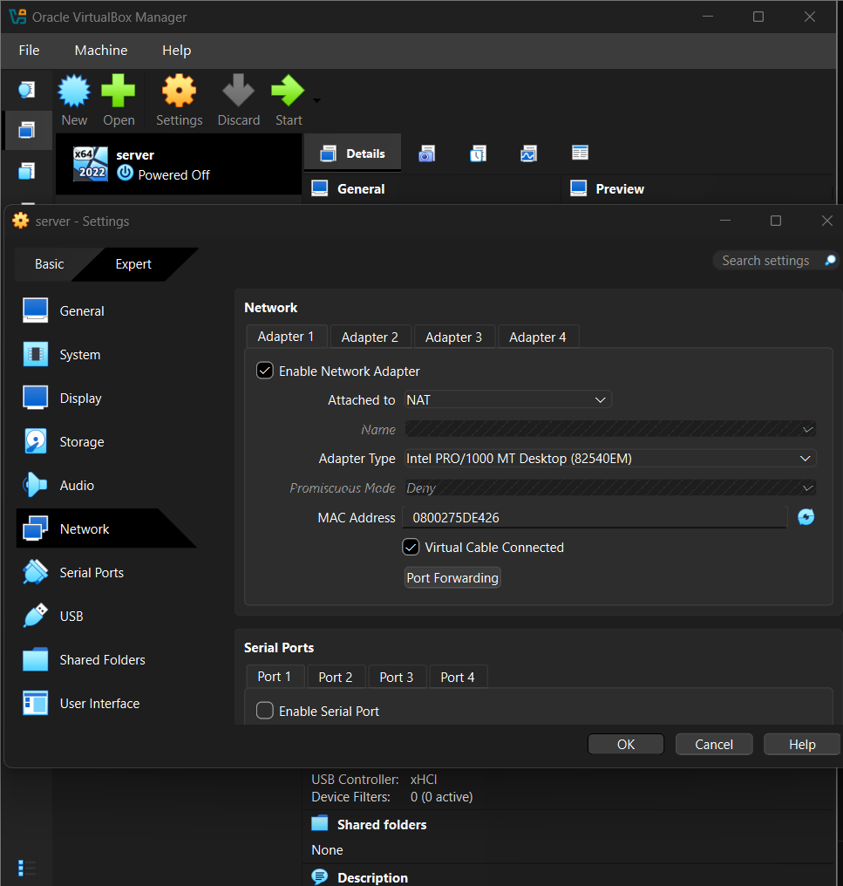
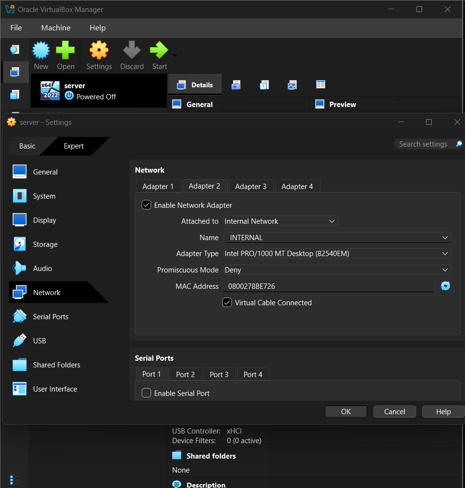
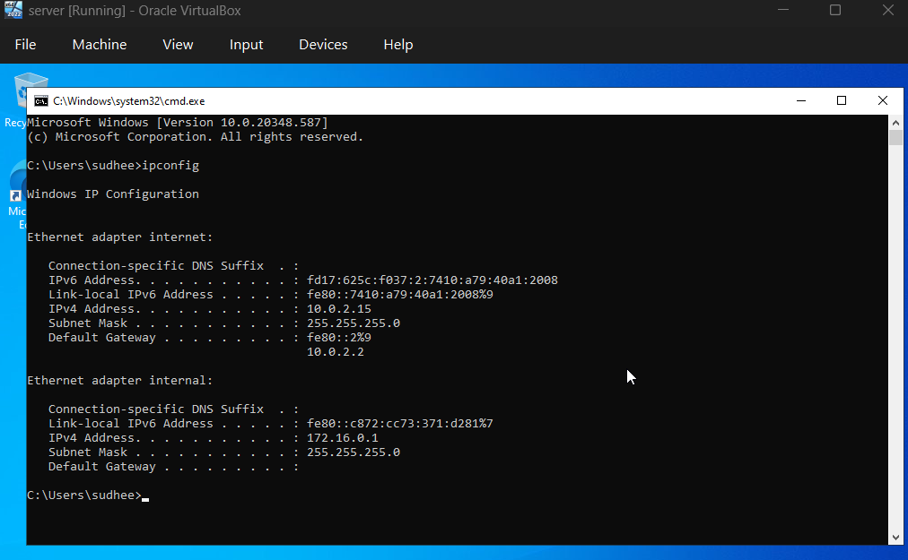
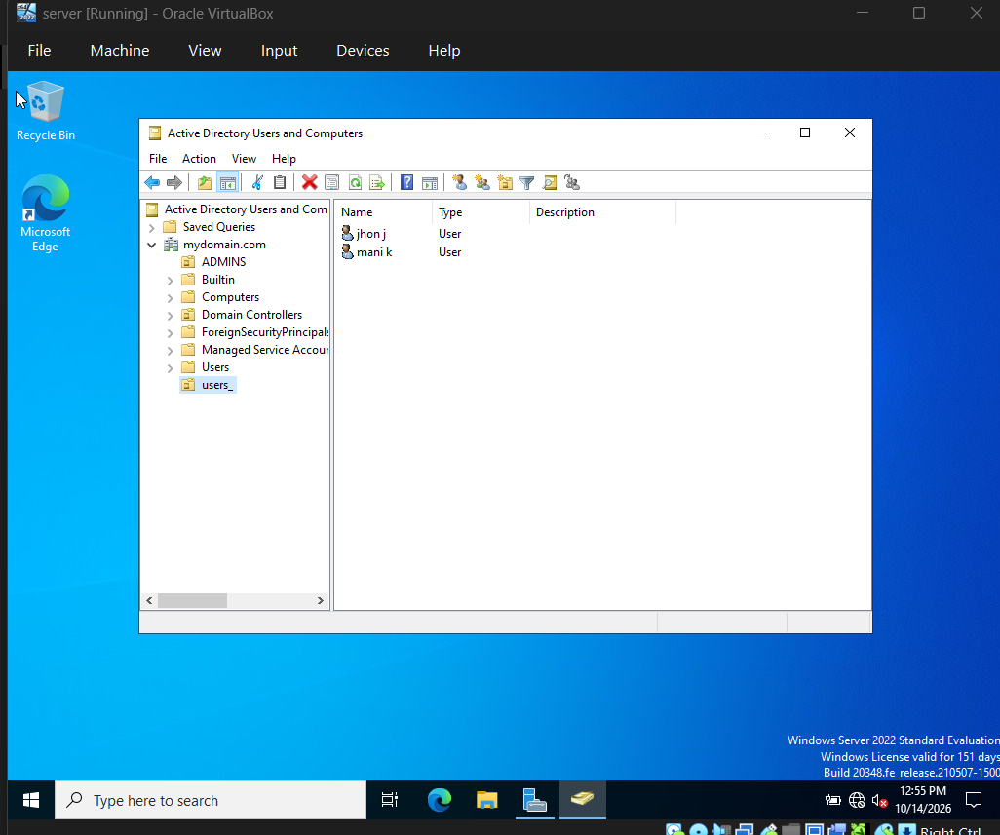
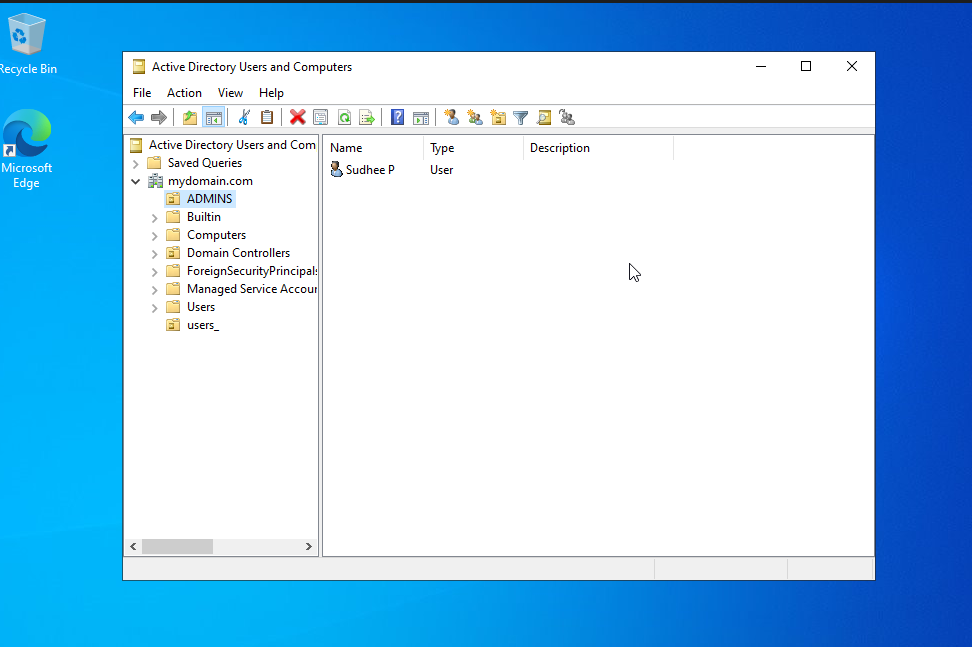
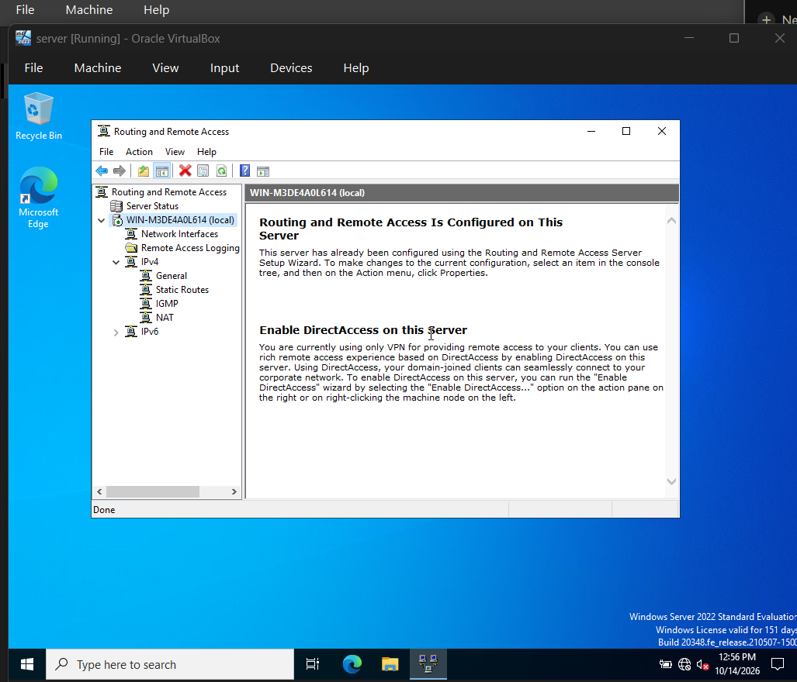
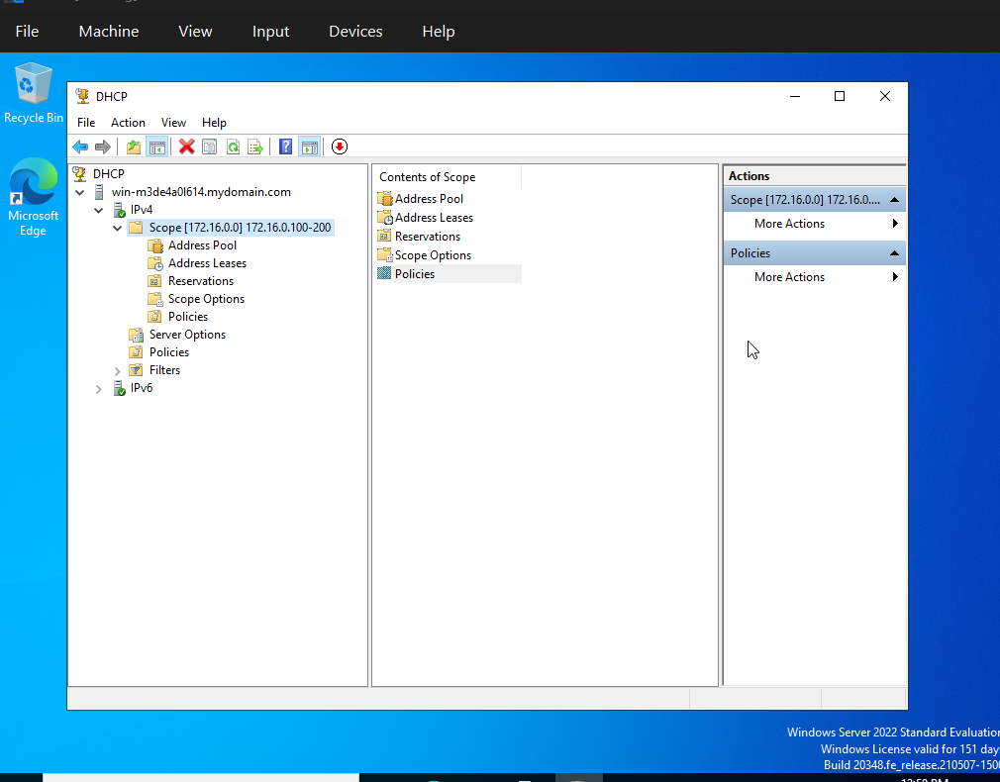
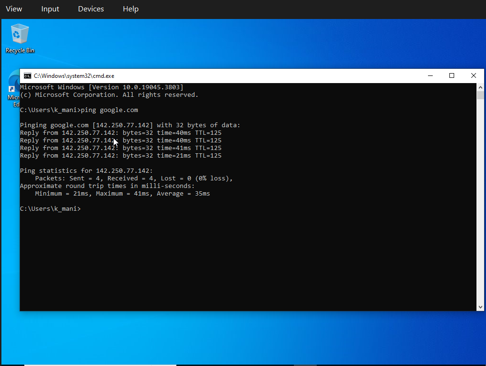
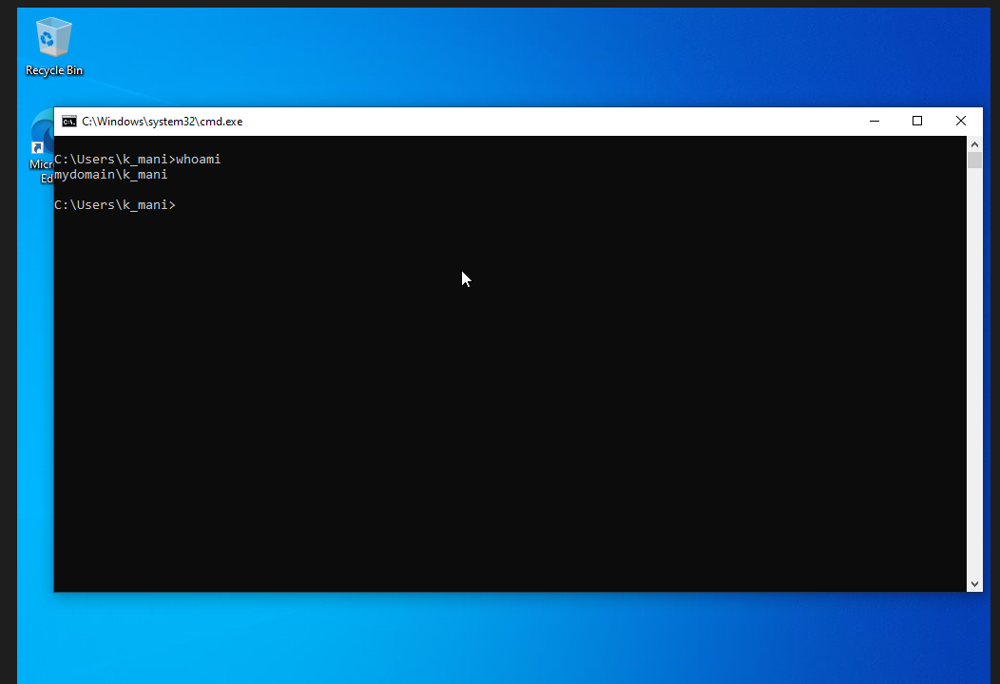

# Active Directory Home Lab (VirtualBox)

A Windows domain lab on VirtualBox: a Windows Server 2022 domain controller providing AD DS, DNS, DHCP and NAT, plus a Windows 10 client joined to the domain. A PowerShell script for bulk user creation is included.

## Skills demonstrated
Active Directory · DNS · DHCP · NAT/Routing (RRAS) · Windows Server 2022 · Windows 10 · PowerShell scripting · Virtualization (VirtualBox) · Domain join and authentication

## Architecture


| | DC (Server 2022) | CLIENT1 (Windows 10) |
|---|---|---|
| Adapter 1 | NAT (named `internet`), DHCP from home router | none |
| Adapter 2 | Internal Network `INTERNAL` (named `internal`), static 172.16.0.1/24 | Internal Network, DHCP from DC |
| Roles | AD DS, DNS, DHCP, Routing (NAT) | Domain member |

**DHCP scope:** 172.16.0.100 – 172.16.0.200 · Mask 255.255.255.0 · Gateway 172.16.0.1 · DNS 172.16.0.1
**Domain:** `mydomain.com`

## What I built
1. Created the DC VM in VirtualBox with two network adapters (NAT and Internal Network).
2. Renamed the adapters and set a static IP on the internal adapter (172.16.0.1, mask 255.255.255.0, no gateway).
3. Installed AD DS and promoted the server to a domain controller with a new forest, `mydomain.com`.
4. Created organizational units (`ADMINS` and a users OU) and domain user accounts.
5. Enabled NAT with Routing and Remote Access so the internal network reaches the internet through the DC.
6. Installed DHCP and created the scope 172.16.0.100–200.
7. Built a Windows 10 client, confirmed it received its address from the DC, and joined it to the domain.
8. Logged in on the client as a domain user.

## Screenshots

### VirtualBox network adapters on the DC



### DC IP configuration
Static 172.16.0.1 on the internal adapter, no gateway, DHCP address on the internet adapter.


### Active Directory



### NAT and DHCP



### Client
CLIENT1 received 172.16.0.100 from the DC, with gateway and DNS 172.16.0.1.





## PowerShell script
[`scripts/create-users.ps1`](scripts/create-users.ps1) reads [`scripts/names.txt`](scripts/names.txt), creates an OU, and creates one account per name (first initial plus last name, for example "Aisha Rahman" becomes `arahman`). Blank lines are skipped.

Run it on the DC in PowerShell ISE as administrator:

```powershell
Set-ExecutionPolicy Unrestricted
cd .\scripts
.\create-users.ps1
```

Set the policy back afterwards:

```powershell
Set-ExecutionPolicy RemoteSigned
```

## Verification
- [x] DC has two adapters; internal adapter is 172.16.0.1/24
- [x] Forest `mydomain.com` created
- [x] NAT configured in Routing and Remote Access
- [x] DHCP scope 172.16.0.100–200 created
- [x] Client received a 172.16.0.x lease with gateway and DNS 172.16.0.1
- [x] Client can ping google.com (0% loss) through the DC
- [x] Client is a member of mydomain.com (`CLIENT1.mydomain.com`)
- [x] Logged in on the client as a domain user (`whoami` returns `mydomain\k_mani`)

## Problems I hit and how I fixed them
- _Add 2–3 of your own real problems here._

## What I learned
- _Write 2–4 sentences in your own words: how DHCP, DNS and AD depend on each other, and how NAT gives the client internet._

## Credit
The lab design follows Josh Madakor's "Basic Home Lab: Active Directory" video. The README, documentation and screenshots are my own.

## Lab only
Passwords in this repo are lab-only values. Do not reuse them anywhere real.
