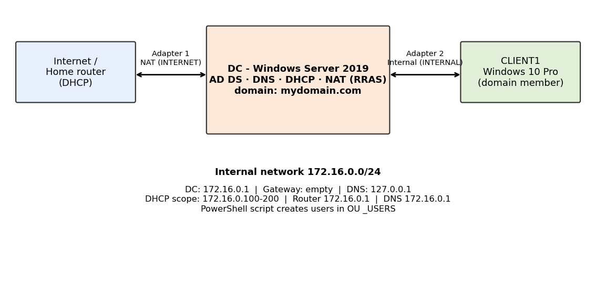
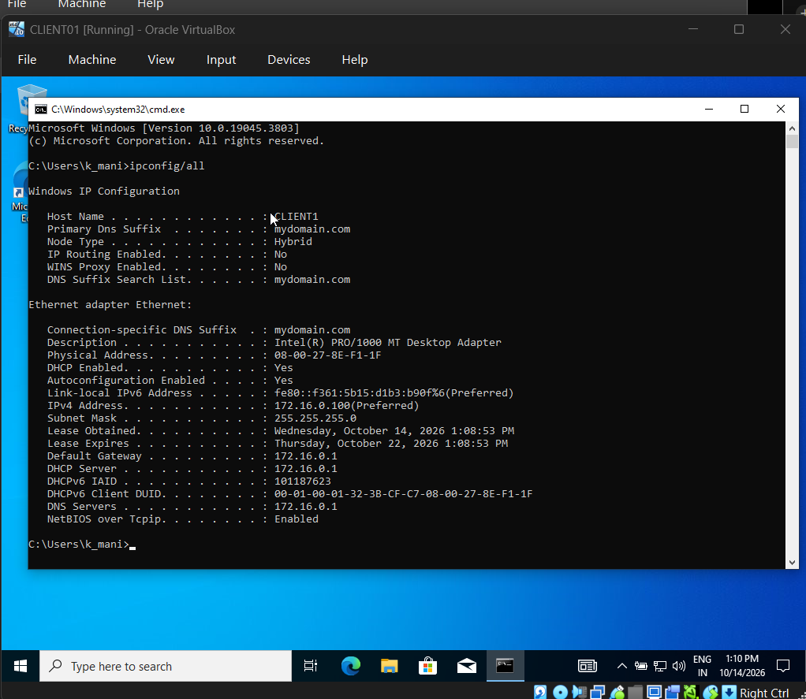
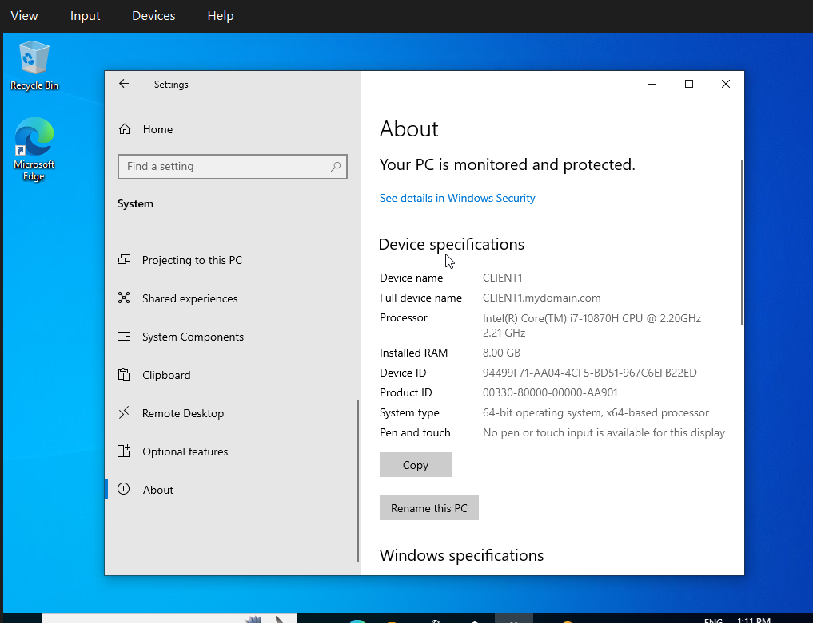

# Active Directory Home Lab (VirtualBox)

A Windows domain lab on VirtualBox: a Windows Server 2019 domain controller providing AD DS, DNS, DHCP and NAT, a Windows 10 client joined to the domain, and a PowerShell script that bulk-creates domain users.

## Skills demonstrated
Active Directory · DNS · DHCP · NAT/Routing (RRAS) · Windows Server 2019 · Windows 10 · PowerShell scripting · Virtualization (VirtualBox) · Domain join and authentication

## Architecture


| | DC (Server 2019) | CLIENT1 (Windows 10 Pro) |
|---|---|---|
| Adapter 1 | NAT (named INTERNET), DHCP from home router | none |
| Adapter 2 | Internal Network (named INTERNAL), static 172.16.0.1/24 | Internal Network, DHCP from DC |
| Roles | AD DS, DNS, DHCP, Routing (NAT) | Domain member |

**DHCP scope:** 172.16.0.100 – 172.16.0.200 · Mask 255.255.255.0 · Gateway 172.16.0.1 · DNS 172.16.0.1
**Domain:** `mydomain.com` (NetBIOS: MYDOMAIN)

## What I built
1. Created the DC VM with two network adapters and installed Windows Server 2019.
2. Renamed the adapters INTERNET and INTERNAL and set a static IP on INTERNAL (172.16.0.1, mask 255.255.255.0, no gateway, DNS 127.0.0.1).
3. Installed AD DS and promoted the server to a domain controller with a new forest.
4. Created a personal domain admin account and used it for administration.
5. Enabled NAT with Routing and Remote Access so the internal network reaches the internet through the DC.
6. Installed DHCP and created a scope for the internal network.
7. Ran a PowerShell script that creates an OU and bulk-creates users from a text file.
8. Built a Windows 10 Pro client, confirmed DHCP and internet access, and joined it to the domain.
9. Logged in on the client as a script-created domain user.

## Screenshots
Add your screenshots to the `screenshots/` folder, then uncomment these lines:

<!--





-->

## PowerShell script
[`scripts/create-users.ps1`](scripts/create-users.ps1) reads [`scripts/names.txt`](scripts/names.txt), creates the `_USERS` OU, and creates one account per name. The username is the first initial plus the last name (for example, "Aisha Rahman" becomes `arahman`). Blank lines are skipped and middle names are handled by using the last word as the surname.

Run it on the DC in PowerShell ISE as administrator:

```powershell
Set-ExecutionPolicy Unrestricted
cd .\scripts
.\create-users.ps1
```

Set the policy back afterwards:

```powershell
Set-ExecutionPolicy RemoteSigned
```

## Verification
- [x] DC has INTERNET and INTERNAL adapters and can ping google.com
- [x] Forest and domain controller created
- [x] NAT enabled on INTERNET
- [x] DHCP scope active and authorized
- [x] Users present in the `_USERS` OU
- [x] Client received a 172.16.0.x lease with gateway and DNS 172.16.0.1
- [x] Client can ping google.com
- [x] Client joined the domain and appears in the Computers container
- [x] Logged in on the client as a generated user

## Problems I hit and how I fixed them
- _Add 2–3 of your own real problems here, for example: client got a 169.254.x.x address because the Internal Network names did not match._
- _Script blocked by the default execution policy, fixed with Set-ExecutionPolicy._

## What I learned
- _Write 2–4 sentences in your own words: how DHCP, DNS and AD depend on each other, how NAT gives the client internet, and why automating user creation matters._

## Credit
The lab design follows Josh Madakor's "Basic Home Lab: Active Directory" video. The README, documentation and script modifications are my own.

## Lab only
Passwords in this repo are lab-only values. Do not reuse them anywhere real.
